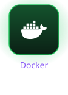

  

## Sobre

Desenvolvo sistemas de dados e inteligência artificial, do tratamento dos dados até a aplicação em produção. Meu trabalho combina machine learning, engenharia de dados e desenvolvimento de APIs, com atenção a qualidade, testes e documentação.

Estudante de Ciência da Computação na UNINASSAU, em Teresina-PI.

## Projetos

| Projeto | O que é | Links |
| --- | --- | --- |
| **NCM Classifier** | Sugere a classificação fiscal NCM de um produto a partir da descrição comercial, com confiança calibrada e aviso quando o caso deve ir para revisão manual. Python, scikit-learn, FastAPI e Next.js. | [Demonstração](https://amanda-gondra.github.io/ncm-classifier/) · [Código](https://github.com/amanda-gondra/ncm-classifier) · [Modelo](https://huggingface.co/AmandaGondra/ncm-classifier) |
| **Análise de Crédito Rural** | Pipeline com os dados oficiais de crédito rural do Banco Central: download com verificação de integridade, validação e carga em PostgreSQL com reconciliação dos totais em SQL. | [Código](https://github.com/amanda-gondra/analise-credito-rural) |
| **Rebanho** | Sistema web full-stack para gestão de gado de corte: animais, pesagens, ganho de peso, lotes e manejo sanitário. Node.js, Fastify, Prisma, PostgreSQL e React. | [Código](https://github.com/amanda-gondra/controle-rebanho) |

## Ferramentas

<table>
<tr>
<td valign="top" align="center" width="400">

**IA e dados**

     

</td>
<td valign="top" align="center" width="400">

**Back-end**

   

</td>
</tr>
<tr>
<td valign="top" align="center" width="400">

**Front-end**

   

</td>
<td valign="top" align="center" width="400">

**Engenharia**

  

</td>
</tr>
</table>

## Contato

[LinkedIn](https://www.linkedin.com/in/amandagondra) · [Hugging Face](https://huggingface.co/AmandaGondra)
